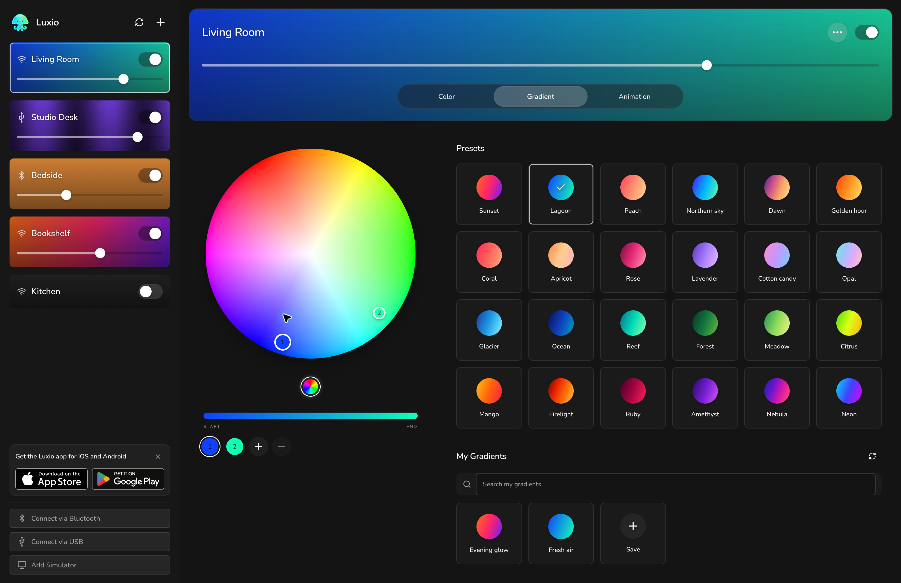

<div align="center">
  
  <h1>Luxio Web App</h1>
  <p>Your lights, your atmosphere. In your browser.</p>
  <p><a href="https://app.luxio.lighting/"><strong>Open Luxio →</strong></a> · <a href="https://luxio.lighting/">Website</a> · <a href="#self-hosting">Self-hosting</a></p>
</div>



Control your Luxio lights, install firmware on an ESP32, and design your own animations—all in one app. The layout adapts from a phone to a wide desktop screen.

## Make yourself at home

- **Set the mood.** Pick a color, blend a gradient, or play an animation. Adjust brightness and save your favorites on your light.
- **Connect your way.** Find lights over Wi-Fi, connect through Bluetooth, or plug in a USB cable.
- **Make something move.** Open **Animation → My Animations → New** to write Lua animations with a live preview and adjustable parameters. Explore the read-only examples and simulate them before creating your own.
- **Start with an ESP32.** Use the sidebar **+** to install Luxio, then configure your LED strip and Wi-Fi.
- **Try it without hardware.** Choose **Try the Simulator** in the empty sidebar, or **Add Simulator** below the connection buttons.

## Connect your lights

Open [app.luxio.lighting](https://app.luxio.lighting/) in an up-to-date Google Chrome browser. For Wi-Fi, use the same network as your lights and allow local network access when prompted. Select a light in the sidebar to start controlling it.

| Connection | What you need |
| --- | --- |
| Wi-Fi | Chrome on desktop or Android, access to the light’s local network, and local network permission. |
| Bluetooth | A browser and operating system with Web Bluetooth support, such as Chrome on macOS, Windows, ChromeOS or Android. Choose **Connect via Bluetooth**. |
| USB / firmware installation | Desktop Chrome and a USB data cable. Choose **Connect via USB**, or **+** to install firmware. |
| Simulator | No light or hardware connection required. |

Safari cannot control a light’s local HTTP endpoint from the hosted HTTPS app. On iPhone or iPad, use the [Luxio iOS app](https://apps.apple.com/app/luxio/id6464080905). There is also a [Luxio Android app](https://play.google.com/store/apps/details?id=lighting.luxio.android).

Browser support depends on the operating system. See Chrome’s documentation for [Bluetooth](https://developer.chrome.com/docs/capabilities/bluetooth), [USB serial](https://developer.chrome.com/docs/capabilities/serial), and [local network access](https://developer.chrome.com/blog/local-network-access).

## Self-hosting

Luxio builds to a folder of static files. You do not need an application server, database, API key, or environment variables. Node.js is only needed to build the app.

### 1. Build

Install **Node.js 24** and Git, then run:

```sh
git clone https://github.com/luxio-lighting/app.luxio.lighting.git
cd app.luxio.lighting
npm ci
npm run build
```

The finished site is in **`dist/`**. Upload its contents to your static web host.

### 2. Serve over HTTPS

Use a dedicated domain or subdomain, such as `https://lights.example.com/`. The app currently expects to live at **`/`**: hosting at a path such as `/luxio/` is not supported by changing Vite’s base setting alone.

Use HTTPS with a certificate trusted by your devices. Bluetooth and USB require a secure context. Plain HTTP on a LAN IP address is not equivalent to `localhost`; it will not enable those browser APIs on your phone or another computer.

For example, with [Caddy](https://caddyserver.com/docs/quick-starts/static-files), copy the contents of `dist/` into `/srv/luxio` and use this Caddyfile:

```caddyfile
lights.example.com {
    root * /srv/luxio
    encode zstd gzip
    file_server
}
```

Replace `lights.example.com` with your domain, point its DNS to your server, and make ports 80 and 443 reachable for Caddy’s [automatic HTTPS](https://caddyserver.com/docs/automatic-https). The Caddy process must be able to read `/srv/luxio`. Start or reload Caddy using your installation’s service manager.

For a local check of the production build:

```sh
npx vite preview --host 127.0.0.1
```

Open the printed URL on the same computer. This is a [local preview server](https://vite.dev/guide/static-deploy.html), not a production hosting service.

### GitHub Pages

The included [GitHub Actions workflow](.github/workflows/build.yml) runs tests, builds the app, and deploys on every push to `main`.

1. Fork this repository and enable GitHub Actions in your fork.
2. Choose **Settings → Pages → Build and deployment → Source → GitHub Actions**.
3. Use your own custom domain and replace `public/CNAME` with that domain. Configure the same domain in Pages settings, set up its DNS, and enable **Enforce HTTPS**.
4. Push to `main`, or run **Build and deploy Luxio** manually from the Actions tab.

Without a custom domain, use a repository named `<your-username>.github.io` and delete `public/CNAME` before building. The usual project Pages URL (`<your-username>.github.io/<repository>/`) serves from a subdirectory and is not supported as-is. Do not leave Luxio’s production domain in your fork’s CNAME file.

### What stays local?

Light controls go directly from your browser to the device. Your hosting server does not need to be on the same network as the light, but your browser does for Wi-Fi control.

Self-hosting changes where the web app is served; automatic discovery and firmware downloads still use Luxio’s online services. The app queries `api.luxio.lighting` for discovery and installation metadata, then downloads firmware from the URLs in that metadata.

Simulator data and animation drafts stay in this browser’s storage. Clearing site data removes them, and moving to another hostname creates a separate workspace. Saved presets on a physical light remain on that light.

To update your self-hosted copy, pull the latest changes, run `npm ci` and `npm run build` again, then replace the deployed files with the new contents of `dist/`.

## Development

```sh
npm ci
npm run dev
```

Open the URL printed in your terminal. Before submitting a change:

```sh
npm run check
npm test
npm run build
```
